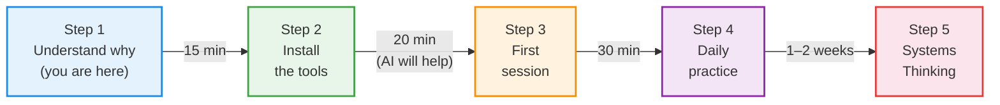
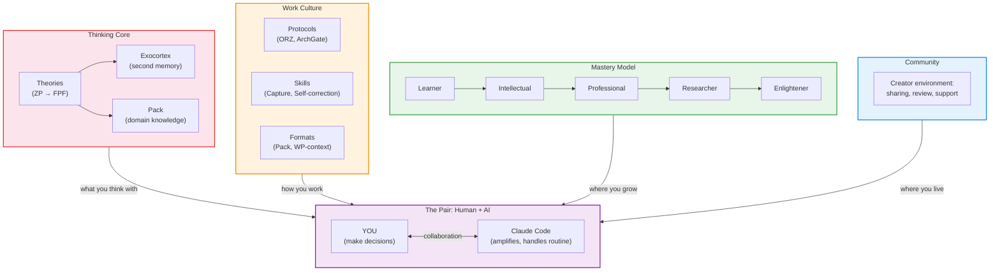
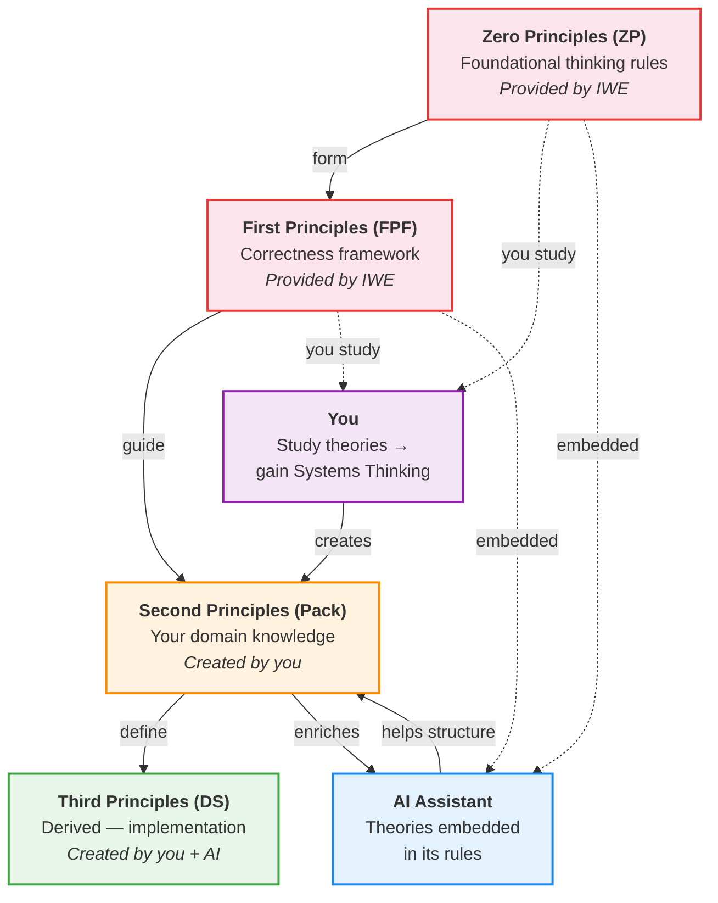

# IWE for Beginners: The Operating System for Intellectual Work

> **Where to start:** ready to act now → [QUICK-START.md](../QUICK-START.md) (15 minutes). Working from a browser (claude.ai), without VS Code → [BROWSER-CI-TEMPLATE.md](../BROWSER-CI-TEMPLATE.md). This file is a conceptual introduction: what IWE is and why it matters.

> **Who this is for:** Anyone encountering IWE for the first time who does not know what GitHub, VS Code, or the command line are. That is fine. You are in the right place.
>
> **What you will get:** An understanding of what IWE is, what it consists of, why it exists — and how to get started without being a programmer.

---

## 1. Your Problem (And It Is Real)

Do any of these sound familiar?

**Knowledge disappears.** You read a book, attend a lecture, take notes — and a month later you cannot find that one idea. Or you find it but have lost the context. Notes in Notion, a notebook, your phone, on a napkin — everywhere and nowhere.

**Plans do not work.** You make a plan for the week, and by Wednesday it is already obsolete. New tasks push out old ones. No priority system, no review — just the feeling that you never get enough done.

**AI does not really help.** You tried ChatGPT or Claude and got polished but generic answers. Every time you start from zero. The AI knows nothing about you: not your projects, not your goals, not what you have already tried.

---

## 2. How IWE Solves This

IWE is an **Intellectual Work Environment** — the operating system for intellectual work. Just as Ubuntu is not simply a collection of programs but a distribution (kernel + packages + configuration + community), IWE is a methodology + a ready-made environment + ongoing support.

### Four Components of IWE

```
IWE — operating system for intellectual work

  Thinking Core      — what you think with (theories, principles, distinctions)
  Work Culture       — how you work (protocols, skills, formats)
  Mastery Model      — where you grow (from Learner to Enlightener)
  Community          — where you live (a Creator environment)
```

**Important:** IWE is a tool. But behind the tool stand theories (Systems Thinking, management, engineering) and Work Culture (14 elements: protocols, skills, formats). Without the theories, the tool remains a notepad with AI. With them, it becomes an exoskeleton for thinking.

### How the Components Solve Each Problem

| Problem | IWE Component | How it works |
|---------|--------------|-------------|
| Knowledge disappears | **Thinking Core** (Exocortex slot + Pack) | Every unit of knowledge has its place. AI helps extract and structure it. Change history is stored in GitHub |
| Plans do not work | **Work Culture** (Work Rhythm (ORZ) rituals + Claude Code) | Morning — day plan (automatic). Evening — wrap-up. Every week — review. AI prevents unfinished work from slipping through |
| AI does not really help | **Thinking Core + Work Culture** | AI reads YOUR files, knows YOUR goals, remembers YOUR history. This is a personal assistant, not an impersonal chatbot |
| I do not know where to grow | **Mastery Model** | A clear trajectory: from beginner to expert. Each Mastery stage — specific skills and outcomes |
| Facing problems alone | **Community** | A Creator environment: experience sharing, review, support |

> More detail on each scenario: [Day Planning](https://github.com/TserenTserenov/PACK-digital-platform/blob/main/pack/digital-platform/08-service-clauses/DP.SC.001-daily-planning.md) | [Week Planning and Review](https://github.com/TserenTserenov/PACK-digital-platform/blob/main/pack/digital-platform/08-service-clauses/DP.SC.002-weekly-planning.md) | [Learning and Development](https://github.com/TserenTserenov/PACK-digital-platform/blob/main/pack/digital-platform/08-service-clauses/DP.SC.003-learning-and-development.md) | [Knowledge Capture and Extraction](https://github.com/TserenTserenov/PACK-digital-platform/blob/main/pack/digital-platform/08-service-clauses/DP.SC.004-knowledge-capture.md)

---

## 3. Your Path: From Zero to a Working IWE



### Step 1. Understand Why (You Are Already Here)

You are reading this document — the first step is done. You recognize that your current way of working with information does not scale. That recognition matters.

### Step 2. Install the Tools (~20 minutes)

You do **not** need to understand programming. Setting up IWE is three actions:

1. Install Claude Code (free)
2. Create a GitHub account (free)
3. Run one command that configures everything else

> **AI will help.** If you have already installed Claude Code — just tell it: "Help me set up IWE." It will walk you through every step.
>
> Detailed instructions: [SETUP-GUIDE.md](../SETUP-GUIDE.md)

**What you need (minimum):**
- A computer (Mac, Linux, or Windows with WSL)
- A paid Claude plan (Pro or higher) — Anthropic's requirement for Claude Code
- A GitHub account (free)

### Step 3. First Strategic Session (~30 minutes)

After installation, launch Claude Code and run your first session:
- Fill in the strategic document (who you are, what matters, where you are headed)
- Formulate 3–5 Work Products (tasks) for the coming week
- AI structures this into a plan

This is not an abstract exercise — you get a working plan immediately.

> More detail: [SETUP-GUIDE.md, Stage 2](../SETUP-GUIDE.md)

### Step 4. Daily Practice (1–2 weeks)

Every day — the same rhythm:
- **Morning:** "Open the day" → Claude shows the plan, events, where you left off
- **Work:** Work, capture conclusions at Work milestones
- **Evening:** "Close the day" → Claude records outcomes, updates plans

After a week you will feel the difference: nothing is lost, everything is in its place.

> More detail: [LEARNING-PATH.md, §5 — Day-to-Day Work](../LEARNING-PATH.md)

### Step 5. Systems Thinking (When You Are Ready)

After 1–2 weeks of practice you will notice that IWE is more than tools. It is built on specific principles. Mastering those principles is the next level. See [Section 6](#6-iwe-map-whats-inside) for details.

> Wondering what happens to your settings when IWE updates? → [Three Layers of IWE](architecture-layers.md) — a short explanation of what updates automatically and what stays yours forever.

---

## 4. Do Not Be Afraid

### "I am not a programmer"

You do not need to be. IWE is an operating system for intellectual work, not for programming. You write texts, plans, and notes. GitHub is simply a reliable storage layer. You will not write code.

### "GitHub, CLI, the terminal — these are scary"

Only the first time. Here is what you actually need to know:
- **GitHub** — a place where files are stored (like Google Drive, but with history)
- **Terminal** — a window where you type commands as text (Claude Code will tell you what to type)
- **CLI** — simply a way to communicate with your computer through text instead of buttons

After installation you will interact primarily with Claude Code — in plain English.

### "This system is too complex"

IWE is not a monolith you must master all at once. It is a modular OS. **The IWE connection path** — you add components to your environment as you need them:

| Stage | What you connect | What you get |
|-------|-----------------|-------------|
| **Stage 1 — Start** | Claude Code + Exocortex slot | A personal AI assistant that remembers you |
| **Stage 2 — Rituals** | + Work Rhythm (ORZ) + day plan | Structured work without losing context |
| **Stage 3 — Knowledge Base** | + Pack + bot | Knowledge base + mobile access |
| **Stage 4 — Automation** | + roles + agents | AI agents that work independently |

> **Stages = what you physically configure in your environment** (not a Mastery stage and not a Platform Tier). Do not confuse: "Steps 1–4" above = the order of your first encounter; Platform Tiers (T0→T4) → [DP.ARCH.002]; Development stage (cp-profile) → FORM.089. More on Platform Tiers: [LEARNING-PATH.md, §9](../LEARNING-PATH.md).

### "Will AI do everything for me?"

No. And that is fundamental. IWE is an **exoskeleton, not a prosthetic**.

- A **prosthetic** replaces a capability. You stop thinking because AI thinks for you.
- An **exoskeleton** extends a capability. It is a partner that lives on your laptop, phone, or in a robot. You think better because AI takes on the routine: reminding, structuring, finding connections.

Your thinking is the primary resource. AI helps you avoid wasting it on searching for a file or restoring context.

> More detail: [principles-vs-skills.md](../principles-vs-skills.md)

---

## 5. The Four Components in Detail

### Thinking Core — What You Think With

Specific **theories** underpin IWE: Systems Thinking, management, enterprise engineering, methodology. These theories are organized into a hierarchy of principles (ZP → FPF → Pack → DS) and embedded in the AI assistant's rules. See [Section 7](#7-theories-and-work-culture--the-foundation-of-iwe) for details.

**Exocortex slot** — your second Memory. A set of files that the AI assistant (Claude Code) reads and updates. When you start work, it knows where you left off yesterday. When you finish, it records your conclusions. You no longer lose context between Sessions.

**Pack** — a knowledge base for a subject Domain. If you are studying marketing, for example, your summaries, rules, and Distinctions accumulate in a Pack. This is not a folder of bookmarks but a structured library where every unit of Knowledge has its place.

### Work Culture — How You Work

Work Culture is not an abstract value. It is **14 concrete elements** divided into three types:

| Type | What it is | Examples |
|------|-----------|---------|
| **Protocols** | Formalized sequences (follow the steps) | Work Rhythm (ORZ), ArchGate, Day Open/Day Close |
| **Skills** | What you develop (apply by situation) | Capture, Self-correction, Distinctions |
| **Formats** | How you present outcomes (to a standard) | Pack structure, WP-context, Collapsible sections |

**Work Rhythm (ORZ) rituals** (Opening → Work → Closing) are the primary Protocol. A simple pattern that repeats at every scale. Start the day — Opening (what am I doing today?). Work — Work turn (capture Knowledge at milestones). Finish — Closing (what did I do, what is next).

### Mastery Model — Where You Grow

A clear trajectory from beginner to expert. Each Mastery stage has specific skills and outcomes. You always know where you stand and what to master next.

### Community — Where You Live

A Creator environment: experience sharing, review, support. Not a question forum but a place where culture and meaning are formed.

### You + Claude Code = A Pair

**You** are at the center of IWE. You make decisions, think, and direct. Claude Code is your Peer partner: it amplifies, structures, and handles routine. But decisions always belong to you.

### Tools (Delivery Vehicles)

Tools are not IWE. They are **delivery vehicles** for the four components:

**Claude Code** — an AI assistant that works directly in the terminal. It does not just answer questions — it reads your files, helps with planning, and reminds you about unfinished work. This is your Peer partner, not a search engine.

**GitHub** — cloud storage with a full history of changes. You can always return to any version of any file.

**VS Code** — a free editor. Not needed at the start — Claude Code works in the terminal. VS Code becomes useful later, when you want to browse files on your own.

**Bot @aist_me_bot** — an assistant in Telegram. Answers questions about your knowledge base and reminds you about tasks. No need to open a computer to stay connected to IWE.

More on theories in the [following sections](#6-iwe-map-whats-inside).

---

## 6. IWE Map: What's Inside

Now that you know why each component exists — here is how they connect:



**Four components — and you at the center:**

| Component | What it is | Simple analogy |
|-----------|-----------|---------------|
| **Thinking Core** | Theories + Exocortex + Pack. The foundation everything builds on | Operating system (Linux kernel) |
| **Work Culture** | Protocols, Skills, Formats — 14 elements | Standard utilities (ls, grep, git) |
| **Mastery Model** | Trajectory from beginner to expert | Package manager (apt install) |
| **Community** | Creator environment: sharing, review, support | Forum + repositories (GitHub community) |

> **Tools** (Claude Code, VS Code, GitHub, bot) are delivery vehicles. Like the hardware that runs the OS.

---

## 7. Theories and Work Culture — The Foundation of IWE

You can install all the tools, configure the rituals, and start keeping plans — and still not get the most out of IWE. Why?

Because **IWE is a tool, but behind the tool stand theories and Work Culture**. Without them, the tool remains a notepad with AI.

### Theories: Where the Principles Come From

IWE is grounded in a body of theories taught in the courses of the [School of Systems Management](https://system-school.ru/):
- **Systems Thinking** — seeing the whole, not just the parts
- **Methodology** — Distinctions, method descriptions, Work Products
- **Enterprise engineering** — how organizations and projects are structured
- **Management** — leadership, direction, Strategizing

These theories are organized into a hierarchy of principles:



| Level | Who creates | Who uses | Example |
|-------|-------------|---------|---------|
| **Zero (ZP)** | IWE | You + AI | Foundational thinking rules |
| **First (FPF)** | IWE | You + AI | Correctness framework, Distinctions |
| **Second (Pack)** | You | You + AI | Your knowledge in marketing, management, engineering |
| **Third (DS)** | You + AI | You + AI | Specific plans, code, processes |

### Work Culture: 14 Elements

Work Culture is the second component of IWE. It is not "motivation" and not "habits." It is a **designed set of methods** divided into three types:

| Type | What it is | Examples | How it is mastered |
|------|-----------|---------|-------------------|
| **Protocols** | Follow the steps (formalized) | Work Rhythm (ORZ), ArchGate, Day Open/Day Close | Follow the instructions → automaticity |
| **Skills** | Apply by situation (developed through practice) | Capture, Self-correction, Distinctions | Practice → feedback → Mastery |
| **Formats** | Present to a standard | Pack structure, WP-context | Use the Template → build the habit |

Work Culture is what people pay for. A tool can be copied, theories can be read. But an established Work Culture is the result of practice that cannot be skipped.

### What Systems Thinking Means (In Plain Terms)

It is the **outcome** of studying theories and applying Work Culture. The ability to see the **whole**, not just the parts:

- You plan a week. Without Systems Thinking — a list of tasks. With it — an understanding of which tasks are connected, which blocks another, what matters more strategically.
- You read a book. Without Systems Thinking — a summary of quotes. With it — Distinctions and principles that can be applied across different contexts.
- You use AI. Without Systems Thinking — random questions. With it — precise requests, because you understand the structure of your work.

### Why IWE Will Not Fully Open Without This

IWE uses specific concepts from its theories:

| Concept | From which theory | Where in IWE | What it means |
|---------|------------------|-------------|--------------|
| **Distinctions** | Methodology | Pack, Exocortex | Precisely defining how one thing differs from another |
| **Method descriptions** | Methodology | Work Rhythm (ORZ) rituals | Understanding *how*, not just *what* |
| **Work Products** | Systems engineering | Planning, review | Focus on outcomes, not activities |
| **Roles** | Management | Strategist, Extractor | Separation: who does what (including AI) |

You can start using IWE **without** a deep understanding of these concepts. But to truly unlock its potential — it is worth learning them. And the more you study, the smarter your AI partner becomes, because you fill the Pack with Knowledge.

### How to Start Learning

1. **First week:** Just use IWE. Get comfortable with the Work Rhythm (ORZ) rituals. Do not go deep into theory yet.
2. **Second week:** Read [principles-vs-skills.md](../principles-vs-skills.md) — a 10-minute introduction to the philosophy of IWE.
3. **After that:** Study [LEARNING-PATH.md, §3 — Thinking Foundation](../LEARNING-PATH.md) at your own pace. The bot @aist_me_bot will help with questions.

> Recommended courses: [School of Systems Management](https://system-school.ru/) — the courses whose theories IWE is built on. Start with: "Systemic Self-Development," "Systems Thinking," "Methodology."

---

## Links and Resources

### Start Now

| Resource | What it is | Link |
|----------|-----------|------|
| Step-by-step installation | 7 stages, from zero to a working IWE | [SETUP-GUIDE.md](../SETUP-GUIDE.md) |
| Learning path | Full mastery program (11 sections) | [LEARNING-PATH.md](../LEARNING-PATH.md) |
| Quick reference | FAQ + 4-day plan | [LEARNING-PATH.md, §11](../LEARNING-PATH.md) |

### Understand More Deeply

| Resource | What it is | Link |
|----------|-----------|------|
| What IWE is | Core definition, Architecture, perimeters | [DP.IWE.001](https://github.com/TserenTserenov/PACK-digital-platform/blob/main/pack/digital-platform/02-domain-entities/DP.IWE.001-intelligent-working-environment.md) |
| Template and setup | Components, Roles, FAQ | [DP.IWE.002](https://github.com/TserenTserenov/PACK-digital-platform/blob/main/pack/digital-platform/02-domain-entities/DP.IWE.002-iwe-template-and-setup.md) |
| principles-vs-skills.md | Why principles matter more than tools | [principles-vs-skills.md](../principles-vs-skills.md) |

### Usage Scenarios

| Scenario | Promise | Link |
|----------|---------|------|
| Day Planning | DayPlan by 08:00 with priorities and context | [DP.SC.001](https://github.com/TserenTserenov/PACK-digital-platform/blob/main/pack/digital-platform/08-service-clauses/DP.SC.001-daily-planning.md) |
| Week Planning and Review | WeekPlan (with an "Outcomes W{N}" section) | [DP.SC.002](https://github.com/TserenTserenov/PACK-digital-platform/blob/main/pack/digital-platform/08-service-clauses/DP.SC.002-weekly-planning.md) |
| Learning and Development | Q&A, Homework Checker, Marathons | [DP.SC.003](https://github.com/TserenTserenov/PACK-digital-platform/blob/main/pack/digital-platform/08-service-clauses/DP.SC.003-learning-and-development.md) |
| Knowledge Capture and Extraction | Fleeting notes → Pack | [DP.SC.004](https://github.com/TserenTserenov/PACK-digital-platform/blob/main/pack/digital-platform/08-service-clauses/DP.SC.004-knowledge-capture.md) |

### Compatibility and Cost

| Parameter | Value |
|-----------|-------|
| OS | macOS, Linux, Windows (via WSL) |
| AI client plan | Claude Pro or higher — Anthropic's requirement for Claude Code |
| GitHub | Free |
| VS Code | Free (needed later, not at the start) |
| Programming knowledge required | No |

> More detail: [PLATFORM-COMPAT.md](../PLATFORM-COMPAT.md) | [FAQ in DP.IWE.002, §11](https://github.com/TserenTserenov/PACK-digital-platform/blob/main/pack/digital-platform/02-domain-entities/DP.IWE.002-iwe-template-and-setup.md)

---

*Created: 2026-03-17 | Updated: 2026-03-27 | WP-120 | [IWE](https://github.com/iwesys/IWE)*