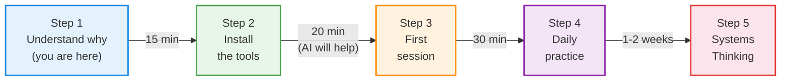
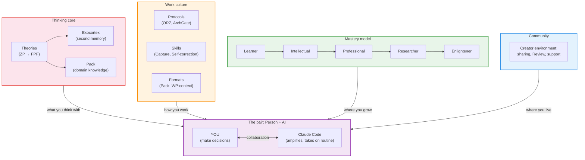
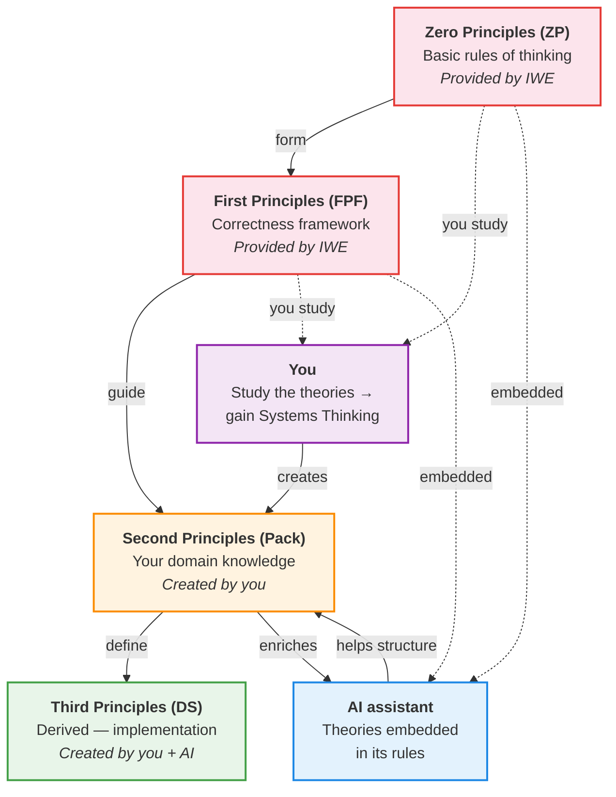

# IWE for Beginners: The Operating System for Intellectual Work

> **Where to start:** ready to act now → [QUICK-START.md](../QUICK-START.md) (15 minutes). Working through a browser (claude.ai) without VS Code → [BROWSER-CI-TEMPLATE.md](../BROWSER-CI-TEMPLATE.md). This file is a conceptual introduction: what IWE is and why it matters.

> **Who this is for:** Anyone who has never heard of IWE and does not know what GitHub, VS Code, or the command line is. That is fine. You are in the right place.
>
> **What you will get:** An understanding of what IWE is, what it consists of, why it exists — and how to get started without being a programmer.

---

## 1. Your problem (and it is real)

Do any of these sound familiar?

**Knowledge gets lost.** You read a book, attend a lecture, take notes — and a month later you cannot find that one idea. Or you find it but cannot remember the context. Notes in Notion, a notebook, your phone, a napkin — everywhere and nowhere.

**Plans do not work.** You make a plan for the week, and by Wednesday it is already obsolete. New tasks push out old ones. No priority system, no Review — just the feeling that nothing gets done.

**AI does not really help.** You tried ChatGPT or Claude and got polished but generic answers. Every conversation starts from zero. The AI knows nothing about you: not your projects, not your goals, not what you have already tried.

---

## 2. How IWE solves this

IWE is an **Intellectual Work Environment** — the operating system for intellectual work. Just as Ubuntu is not simply a collection of programs but a distribution (kernel + packages + configuration + community), IWE is a methodology + a ready-made environment + ongoing support.

### Four components of IWE

```
IWE — operating system for intellectual work

  Thinking core      — what you think with (theories, principles, distinctions)
  Work culture       — how you work (protocols, skills, formats)
  Mastery model      — where you grow (from Learner to Enlightener)
  Community          — where you live (a Creator environment)
```

**Important:** IWE is a tool. But behind the tool are theories (Systems Thinking, management, engineering) and work culture (14 elements: protocols, skills, formats). Without the theories the tool remains a notebook with AI. With the theories it becomes an exoskeleton for thinking.

### How the components solve the problems

| Problem | IWE component | How it works |
|---------|--------------|-------------|
| Knowledge gets lost | **Thinking core** (Exocortex + Pack) | Every unit of knowledge has its place. AI helps extract and structure it. The change history is stored in GitHub |
| Plans do not work | **Work culture** (ORZ rituals + Claude Code) | Morning — day plan (automatically). Evening — results. Every week — Review. AI prevents unfinished work from being forgotten |
| AI does not help | **Thinking core + work culture** | AI reads YOUR files, knows YOUR goals, remembers YOUR history. It is a personal assistant, not an anonymous chatbot |
| I do not know where to grow | **Mastery model** | A clear trajectory from beginner to expert. Each Mastery stage has concrete skills and results |
| I face problems alone | **Community** | A Creator environment: experience sharing, Reviews, support |

> More about each scenario: [Day Planning](https://github.com/TserenTserenov/PACK-digital-platform/blob/main/pack/digital-platform/08-service-clauses/DP.SC.001-daily-planning.md) | [Week Planning and Review](https://github.com/TserenTserenov/PACK-digital-platform/blob/main/pack/digital-platform/08-service-clauses/DP.SC.002-weekly-planning.md) | [Learning and Development](https://github.com/TserenTserenov/PACK-digital-platform/blob/main/pack/digital-platform/08-service-clauses/DP.SC.003-learning-and-development.md) | [Knowledge Capture and Extraction](https://github.com/TserenTserenov/PACK-digital-platform/blob/main/pack/digital-platform/08-service-clauses/DP.SC.004-knowledge-capture.md)

---

## 3. Your path: from zero to a working IWE



### Step 1. Understand why (you are already here)

You are reading this document — the first step is done. You recognise that your current way of working with information does not scale. That is an important insight.

### Step 2. Install the tools (~20 minutes)

You do **not** need to understand programming. Setting up IWE is three actions:

1. Install Claude Code (free)
2. Create a GitHub account (free)
3. Run one command that configures everything else

> **AI will help.** If you have already installed Claude Code — just tell it: "Help me set up IWE." It will walk you through every step.
>
> Detailed instructions: [SETUP-GUIDE.md](../SETUP-GUIDE.md)

**What you need (minimum):**
- A computer (Mac, Linux, or Windows with WSL)
- A paid Claude plan (Pro or higher) — Anthropic's requirement for Claude Code
- A GitHub account (free)

### Step 3. First strategic session (~30 minutes)

After installation you launch Claude Code and run your first session:
- If you already have your own projects and notes — the AI first marks them up and checks with you that it understood them correctly
- You fill in a strategic document (who you are, what matters, where you are headed)
- You formulate 3–5 Work Products (tasks) for the coming week
- AI structures this into a plan

This is not an abstract exercise — you get a working plan immediately.

> More detail: [SETUP-GUIDE.md, stage 2](../SETUP-GUIDE.md)

### Step 4. Daily practice (1–2 weeks)

Every day follows the same rhythm:
- **Morning:** "Open the day" → Claude shows the plan, events, where you left off
- **Work:** You work and record conclusions at Work milestones
- **Evening:** "Close the day" → Claude records the results and updates the plans

After a week you will feel the difference: nothing is lost, everything is in its place.

> More detail: [LEARNING-PATH.md, §5 — Day-to-day work](../LEARNING-PATH.md)

### Step 5. Systems Thinking (when you are ready)

After 1–2 weeks of practice you will notice that IWE is more than tools. It is built on specific principles. Mastering those principles is the next level. See [section 6](#6-iwe-map-whats-inside) for more.

> Wondering what happens to your settings when IWE updates? → [Three IWE layers](architecture-layers.md) — a brief explanation of what updates automatically and what stays yours forever.

---

## 4. Do not be afraid

### "I am not a programmer"

You do not need to be. IWE is an operating system for intellectual work, not for programming. You write texts, plans, and notes. GitHub is simply a reliable storage system. You will not write code.

### "GitHub, CLI, terminal — these are scary"

Only the first time. Here is what you actually need to know:
- **GitHub** — where files are stored (like Google Drive, but with a full history)
- **Terminal** — a window where you type commands as text (Claude Code tells you what to type)
- **CLI** — simply a way to talk to your computer through text instead of buttons

After installation you will interact mainly with Claude Code — in plain English.

### "This system is too complicated"

IWE is not a monolith you must master all at once. It is a modular OS. **The IWE connection path** — you add components to your environment as you need them:

| Stage | What you connect | What you get |
|-------|-----------------|--------------|
| **Stage 1 — Start** | Claude Code + Exocortex | A personal AI assistant that remembers you |
| **Stage 2 — Rituals** | + ORZ + day plan | Structured work without losing context |
| **Stage 3 — Knowledge base** | + Pack + bot | Knowledge base + mobile access |
| **Stage 4 — Automation** | + roles + agents | AI agents that work independently |

> **Stages = what you physically configure in your environment** (not a Mastery stage and not an access tier). Do not confuse: "Steps 1–4" above = the order for first-time orientation; Platform access tiers (T0→T4) → [DP.ARCH.002]; Development stage (cp-profile) → FORM.089. More about access tiers: [LEARNING-PATH.md, §9](../LEARNING-PATH.md).

### "Will AI do everything for me?"

No. And that distinction matters. IWE is an **exoskeleton, not a prosthetic**.

- A **prosthetic** replaces a capability. You stop thinking because AI thinks for you.
- An **exoskeleton** extends a capability. It is a partner that lives on your laptop, phone, or in a robot. You think better because AI takes on the routine: reminders, structuring, finding connections.

Your thinking is the primary resource. AI helps you not waste it on searching for a file or restoring context.

> More detail: [Principles vs Skills](../principles-vs-skills.md)

---

## 5. The four components in detail

### Thinking core — what you think with

IWE rests on specific **theories**: Systems Thinking, management, enterprise engineering, methodology. These theories are organised into a hierarchy of principles (ZP → FPF → Pack → DS) and embedded in the AI assistant's rules. See [section 7](#7-theories-and-work-culture--the-foundation-of-iwe) for more.

**Exocortex** — your second memory. A set of files that the AI assistant (Claude Code) reads and updates. When you start work it knows where you left off yesterday. When you finish it records the conclusions. You no longer lose context between sessions.

**Pack** — a knowledge base for a subject domain. If you are studying marketing, for example, your summaries, rules, and distinctions are assembled into a Pack. This is not a folder of bookmarks but a structured library where every unit of knowledge has its place.

### Work culture — how you work

Work culture is not an abstract value. It consists of **14 concrete elements** divided into three types:

| Type | What it is | Examples |
|------|-----------|---------|
| **Protocols** | Formalised sequences (you follow the steps) | ORZ, ArchGate, Day Open/Day Close |
| **Skills** | What you develop (applied to the situation) | Capture, Self-correction, distinctions |
| **Formats** | How you shape a result (to a standard) | Pack structure, WP-context, collapsible sections |

**ORZ rituals** (Opening → Work → Closing) — the core protocol. A simple pattern that repeats at every scale. Starting the day — Opening (what do I do today?). Working — Work (record knowledge at milestones). Finishing — Closing (what did I do, what is next).

### Mastery model — where you grow

A clear trajectory from beginner to expert. Each Mastery stage has concrete skills and results. You always know where you stand and what to develop next.

### Community — where you live

A Creator environment: experience sharing, Reviews, support. Not a question-and-answer forum but a place where culture and meaning are formed.

### You + Claude Code = a pair

At the centre of IWE is **you**. You make decisions, think, and set direction. Claude Code is your Peer partner: it amplifies, structures, and takes on the routine. But decisions always belong to you.

### Tools (delivery mechanisms)

Tools are not IWE. They are **delivery mechanisms** for the four components:

**Claude Code** — an AI assistant that works directly in the terminal. It does not just answer questions — it reads your files, helps you plan, and reminds you of unfinished work. It is your Peer partner, not a search engine.

**GitHub** — cloud storage with a complete change history. You can always return to any version of any file.

**VS Code** — a free editor. You do not need it at the start — Claude Code works in the terminal. VS Code becomes useful later when you want to browse files on your own.

**Bot @aist_me_bot** — an assistant in Telegram. It answers questions about your knowledge base and reminds you of tasks. You do not need to open your computer to stay connected to IWE.

More about the theories: see the [following sections](#6-iwe-map-whats-inside).

---

## 6. IWE map: what is inside

Now that you know why each component exists, here is how they connect:



**Four components — and you at the centre:**

| Component | What it is | Simple analogy |
|-----------|-----------|----------------|
| **Thinking core** | Theories + Exocortex + Pack. The foundation everything builds on | Operating system (Linux kernel) |
| **Work culture** | Protocols, skills, formats — 14 elements | Standard utilities (ls, grep, git) |
| **Mastery model** | Trajectory from beginner to expert | Package manager (apt install) |
| **Community** | Creator environment: sharing, Reviews, support | Forum + repositories (GitHub community) |

> **Tools** (Claude Code, VS Code, GitHub, bot) are delivery mechanisms. Like the hardware an OS runs on.

---

## 7. Theories and work culture — the foundation of IWE

You can install all the tools, configure the rituals, and start keeping plans — and still not get the full value from IWE. Why?

Because **IWE is a tool, but behind the tool are theories and work culture**. Without them the tool remains a notebook with AI.

### Theories: where the principles come from

IWE rests on a body of theories taught in [Masters of Systems Engineering and Management](https://system-school.ru/) courses:
- **Systems Thinking** — seeing the whole, not just the parts
- **Methodology** — distinctions, method descriptions, Work Products
- **Enterprise engineering** — how organisations and projects are structured
- **Management** — leadership, direction, Strategizing

These theories are organised into a hierarchy of principles:



| Level | Who creates it | Who uses it | Example |
|-------|---------------|------------|---------|
| **Zero (ZP)** | IWE | You + AI | Basic rules of thinking |
| **First (FPF)** | IWE | You + AI | Correctness framework, distinctions |
| **Second (Pack)** | You | You + AI | Your knowledge in marketing, management, engineering |
| **Third (DS)** | You + AI | You + AI | Specific plans, code, processes |

### Work culture: 14 elements

Work culture is the second component of IWE. It is not "motivation" or "habits." It is a **designed set of methods** divided into three types:

| Type | What it is | Examples | How it is developed |
|------|-----------|---------|---------------------|
| **Protocols** | Follow the steps (formalised) | ORZ, ArchGate, Day Open/Day Close | Follow the instructions → automatism |
| **Skills** | Apply to the situation (built through practice) | Capture, Self-correction, distinctions | Practice → feedback → Mastery |
| **Formats** | Shape output to a standard | Pack structure, WP-context | Use the template → it becomes second nature |

Work culture is what people pay for. A tool can be copied; theories can be read. But an established work culture is the result of practice that cannot be skipped.

### What Systems Thinking is (in plain words)

It is the **result** of studying the theories and applying work culture. The ability to see the **whole**, not just the parts:

- You plan a week. Without Systems Thinking — a list of tasks. With it — an understanding of which tasks are connected, which one blocks another, and what matters strategically.
- You read a book. Without Systems Thinking — a collection of quotes. With it — distinctions and principles you can apply in different contexts.
- You use AI. Without Systems Thinking — random questions. With it — precise requests, because you understand the structure of your own work.

### Why IWE will not fully open without this

IWE uses specific concepts from the theories:

| Concept | From which theory | Where in IWE | What it means |
|---------|------------------|-------------|---------------|
| **Distinctions** | Methodology | Pack, Exocortex | Defining precisely how one thing differs from another |
| **Method descriptions** | Methodology | ORZ rituals | Understanding the "how", not just the "what" |
| **Work Products** | Systems engineering | Planning, Review | Focus on results, not activities |
| **Roles** | Management | Strategist, Extractor | Separation: who does what (including AI) |

You can start using IWE **without** a deep understanding of these concepts. But to fully unlock its potential you should explore them. The more you study, the smarter your AI Peer partner becomes — because you fill the Pack with knowledge.

### How to start learning

1. **Week 1:** Just use IWE. Get comfortable with the ORZ rituals. Do not go deep into theory.
2. **Week 2:** Read [Principles vs Skills](../principles-vs-skills.md) — a 10-minute introduction to the philosophy of IWE.
3. **After that:** Study [LEARNING-PATH.md, §3 — Thinking foundation](../LEARNING-PATH.md) at your own pace. The bot @aist_me_bot will help with questions.

> Recommended courses: [Masters of Systems Engineering and Management](https://system-school.ru/) — the courses whose theories IWE is built on. Start with: "Systemic Self-Development," "Systems Thinking," "Methodology."

---

## Links and resources

### Start now

| Resource | What it is | Link |
|----------|-----------|------|
| Step-by-step installation | 7 stages, from zero to a working IWE | [SETUP-GUIDE.md](../SETUP-GUIDE.md) |
| Learning path | Full mastery program (11 sections) | [LEARNING-PATH.md](../LEARNING-PATH.md) |
| Quick reference | FAQ + 4-day plan | [LEARNING-PATH.md, §11](../LEARNING-PATH.md) |

### Go deeper

| Resource | What it is | Link |
|----------|-----------|------|
| What IWE is | Core definition, architecture, perimeters | [DP.IWE.001](https://github.com/TserenTserenov/PACK-digital-platform/blob/main/pack/digital-platform/02-domain-entities/DP.IWE.001-intelligent-working-environment.md) |
| Template and setup | Components, roles, FAQ | [DP.IWE.002](https://github.com/TserenTserenov/PACK-digital-platform/blob/main/pack/digital-platform/02-domain-entities/DP.IWE.002-iwe-template-and-setup.md) |
| Principles vs Skills | Why principles matter more than tools | [principles-vs-skills.md](../principles-vs-skills.md) |

### Usage scenarios

| Scenario | Promise | Link |
|----------|---------|------|
| Day Planning | DayPlan by 08:00 with priorities and context | [DP.SC.001](https://github.com/TserenTserenov/PACK-digital-platform/blob/main/pack/digital-platform/08-service-clauses/DP.SC.001-daily-planning.md) |
| Week Planning and Review | WeekPlan (with a "Results W{N}" section) | [DP.SC.002](https://github.com/TserenTserenov/PACK-digital-platform/blob/main/pack/digital-platform/08-service-clauses/DP.SC.002-weekly-planning.md) |
| Learning and Development | Q&A, Homework Checker, marathons | [DP.SC.003](https://github.com/TserenTserenov/PACK-digital-platform/blob/main/pack/digital-platform/08-service-clauses/DP.SC.003-learning-and-development.md) |
| Knowledge Capture and Extraction | Fleeting notes → Pack | [DP.SC.004](https://github.com/TserenTserenov/PACK-digital-platform/blob/main/pack/digital-platform/08-service-clauses/DP.SC.004-knowledge-capture.md) |

### Compatibility and cost

| Parameter | Value |
|-----------|-------|
| OS | macOS, Linux, Windows (via WSL) |
| AI client plan | Claude Pro or higher — Anthropic's requirement for Claude Code |
| GitHub | Free |
| VS Code | Free (needed later, not at the start) |
| Programming knowledge required | No |

> More detail: [PLATFORM-COMPAT.md](../PLATFORM-COMPAT.md) | [FAQ in DP.IWE.002, §11](https://github.com/TserenTserenov/PACK-digital-platform/blob/main/pack/digital-platform/02-domain-entities/DP.IWE.002-iwe-template-and-setup.md)

---

*Created: 2026-03-17 | Updated: 2026-03-27 | WP-120 | [IWE](https://github.com/iwesys/IWE)*

